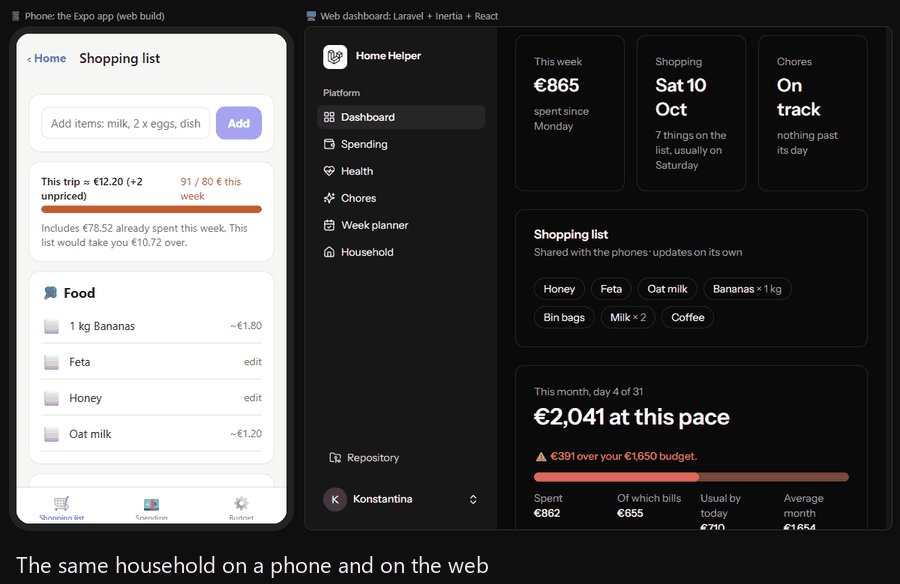
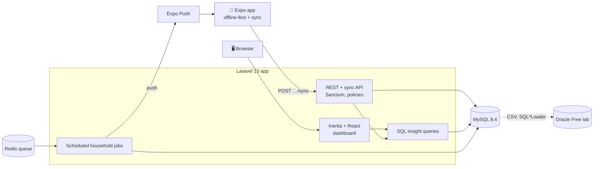

# 🏠 Home Helper API

[](https://github.com/kgiannopoulou/home-helper-api/actions/workflows/tests.yml)

**The shared household server for [Personal Home Helper](https://github.com/kgiannopoulou/personal-home-helper)**, an offline-first Expo app for money, kitchen, shopping, chores, health and planning. This Laravel app gives a household one shared copy of its data: a REST + sync API for the phones, scheduled jobs that push to them, and a React dashboard, all on MySQL. An Oracle lab runs the same data through partitioning, backup and recovery.



*Yoghurt is added on the phone (left) and appears on the web dashboard (right) 16 seconds later.*

## In 30 seconds

| | |
|---|---|
| **PHP, Laravel 13** | REST + sync API with Sanctum, policies and Form Requests. [OpenAPI document](docs/openapi.json) generated from the code. Queued jobs on Redis, the scheduler and Expo push. **294 Pest tests on real MySQL**, including a sweep that proves every route needs a token and refuses non-members |
| **MySQL 8.4** | 28 normalized tables with foreign keys, CHECK constraints, generated columns and soft-delete-safe unique keys ([ER diagrams](docs/database.md)). Window functions, CTEs, a view, and `EXPLAIN ANALYZE` before/after: [1,400× faster](docs/insights.md) |
| **React** | Inertia + React + TypeScript dashboard with Recharts and a week planner ([dashboard](docs/dashboard.md)). Vitest + React Testing Library |
| **Oracle basics** | Interval partitions, ARCHIVELOG, `EXCHANGE PARTITION` archiving, RMAN level 0/1, Data Pump and four timed recovery drills ([runbook](ops/oracle/RUNBOOK.md)) |
| **API hygiene** | One error format with codes and request ids, per-user rate limits, consistent paging/sorting/filtering ([API reference](docs/api.md)) |
| **CI** | GitHub Actions: MySQL service, migrate, Pint, Pest, build, `tsc`, Vitest, and a check that the generated docs are current |

## Architecture



## Quick start

```bash
composer install && npm install
cp .env.example .env && php artisan key:generate
docker compose up -d mysql redis
php artisan migrate:fresh --seed       # 6 months of demo data
composer run dev                       # http://localhost:8000, API docs at /docs/api
```

Sail, Windows notes, queue workers and tests: [docs/development.md](docs/development.md).

### Demo accounts

`DemoSeeder` builds one household ("Patission 12") with six months of data up to today, from a fixed random seed: weekly shops with creeping prices, rent and bills, one month over budget, a chore that keeps slipping, and health logs.

| Email | Password | Role |
|---|---|---|
| `demo@homehelper.test` | `password` | Owner: can invite, sees the owner's personal logs |
| `alex@homehelper.test` | `password` | Member: shares the household data, but not the owner's personal logs |

```bash
TOKEN=$(curl -s -X POST localhost:8000/api/login -H 'Accept: application/json' \
  -d email=demo@homehelper.test -d password=password | jq -r .token)
curl -s localhost:8000/api/households -H "Authorization: Bearer $TOKEN" | jq
```

## Documentation

| | |
|---|---|
| [API reference](docs/api.md) | Endpoints, list parameters, error format and codes, rate limits, how access is enforced |
| [OpenAPI document](docs/openapi.json) | Generated by Scramble; browse it interactively at `/docs/api` |
| [Database diagrams](docs/database.md) | Mermaid ER diagrams generated from the live schema (`php artisan docs:schema`) |
| [Database design](docs/database-design.md) | Households and personal data, ULIDs, soft-delete-safe unique keys, CHECK constraints |
| [Sync between phones](docs/sync.md) | Last write wins, tombstones, natural keys, a server-clock cursor |
| [Insights in SQL](docs/insights.md) | Window functions and CTEs, with `EXPLAIN ANALYZE` before and after |
| [Scheduled jobs and push](docs/jobs.md) | Shopping list, bills, budget alerts, weekly summary |
| [Web dashboard](docs/dashboard.md) | Inertia pages, charts and the week planner |
| [Oracle lab](docs/oracle.md) | Partitioning, archiving, RMAN, Data Pump and recovery drills |
| [Development](docs/development.md) | Running it, the test suite, generated docs |

## Stack

Laravel 13 · PHP 8.4 · Pest · MySQL 8.4 · Redis · Inertia + React 19 + TypeScript · Recharts · Vitest · Scramble (OpenAPI) · Docker · GitHub Actions · Oracle AI Database 26ai Free (lab). Phone app: [personal-home-helper](https://github.com/kgiannopoulou/personal-home-helper) (Expo, React Native).
