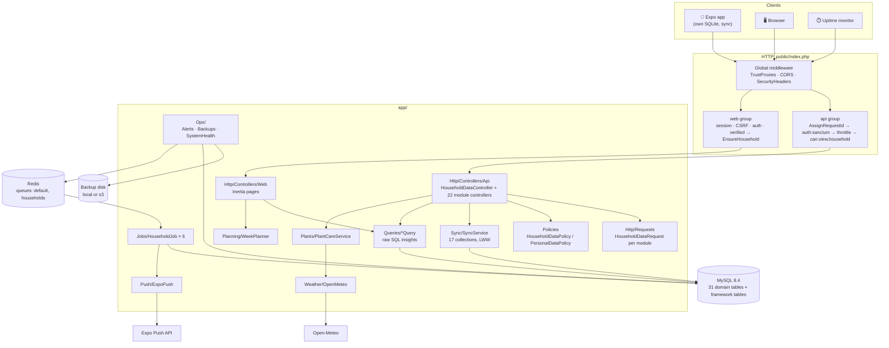

# Architecture

How the server is put together, as of November 2026. Written as the first step of [Phase 1](phase-1.md): what exists, before changing anything. [architecture-review.md](architecture-review.md) has the problems found, and what was fixed.

## What it is

One Laravel 13 app with three jobs:

1. **The household's shared copy of its data.** Phones run [Personal Home Helper](https://github.com/kgiannopoulou/personal-home-helper) offline-first and sync here. Without a household the phone works alone and never calls the server.
2. **Work no single phone can do:** scheduled jobs across the household's data (bills, shopping list, budget alerts, weekly summary, plant care) that push to every member's phone.
3. **A web dashboard** for the same household: charts, insights and a week planner.

## Layers

| Layer | Where | What it does |
|---|---|---|
| Routes | `routes/api.php`, `routes/web.php`, `routes/console.php` | API under `/api`, Inertia pages, the schedule |
| Middleware | `app/Http/Middleware`, `bootstrap/app.php` | Request ids, security headers, current household for the web, Inertia shared props |
| Controllers | `app/Http/Controllers/{Api,Web,Settings}` | Thin. Every API module controller extends `HouseholdDataController`, which does scoping, filters, sorting, paging and policies |
| Form Requests | `app/Http/Requests` | One per module, written as the create rules; PATCH relaxes them. `inHousehold()` rules keep ids inside the household |
| Policies | `app/Policies` | `HouseholdDataPolicy` (any member), `PersonalDataPolicy` (only the person who logged it), `HouseholdPolicy` (owner-only actions) |
| Domain services | `app/Sync`, `app/Planning`, `app/Plants`, `app/Actions` | Sync, the week planner, plant care rules, inviting a member |
| Queries | `app/Queries` | Insights as hand-written SQL (window functions, CTEs), each with `explainAnalyze()` |
| Jobs | `app/Jobs` | `HouseholdJob` fans out one queued job per household, logs each run in `job_runs` |
| Integrations | `app/Push`, `app/Weather` | Expo push, Open-Meteo forecast (behind an interface, cached) |
| Ops | `app/Ops`, `app/Console/Commands` | Alerts, backups and restore tests, system health, the production check |
| Models | `app/Models` | ULID ids, `BelongsToHousehold` trait, enums in `app/Enums` |
| Frontend | `resources/js` | Inertia + React 19 + TypeScript, Recharts, Wayfinder for typed routes |

## The data model in one paragraph

Everything belongs to a **household** (`household_id`, never fillable, taken from the URL). A user joins through `household_user` with a role (owner or member). Shared modules (money, shopping, kitchen, chores, plants, planner) are visible to every member; personal health logs (food, water, sleep, workouts, weight, steps) only to the person who logged them. Synced tables share the same bookkeeping: ULIDs, millisecond `created_at`/`updated_at`, soft deletes as tombstones, a server-clock `synced_at` cursor, and a generated `alive` column so unique keys ignore deleted rows. Diagrams: [database.md](database.md). Reasons: [database-design.md](database-design.md).

## Request flows

**A phone saves an expense.** `POST /api/households/{h}/expenses` → `AssignRequestId` (id into the log context) → `auth:sanctum` (bearer token, 90-day expiry) → `throttle:api` (120/min per user) → `can:view,household` (403 for non-members) → `ExpenseRequest` (validation, ids must be in the household) → `ExpenseController::store` → policy `create` → saved with `household_id` from the URL → `ExpenseResource`. Any error comes back in the one error format with `code` and `request_id` (`bootstrap/app.php`).

**A phone syncs.** `POST …/sync` with changes per collection since its cursor → `SyncService` applies them last-write-wins on `updated_at` (natural keys join rows made offline on two phones), then returns everything changed since the cursor, using the server's clock. [sync.md](sync.md).

**18:00 at home.** The scheduler dispatches `BudgetAlert` with no household → it fans out one job per household on the `households` queue → each compares the month's spending to the budget and pushes once per 10% step. A job that fails three times raises an ops alert. [jobs.md](jobs.md).

**The dashboard.** `GET /dashboard` → session auth → `EnsureHousehold` (picks the current household) → `DashboardController` runs insight queries → Inertia renders `dashboard.tsx`, which polls every 10 s so what a phone syncs shows up.

## Running processes

| Process | Command | Notes |
|---|---|---|
| Web/API | PHP-FPM or `php artisan serve` | Stateless; scale out behind a proxy (`TRUSTED_PROXIES`) |
| Queue workers | `php artisan queue:work redis --queue=default,households` | Supervisor config in `ops/deploy/` |
| Scheduler | `* * * * * php artisan schedule:run` | `onOneServer()` on every task, so two servers don't double-run |
| MySQL 8.4 | | The only source of truth |
| Redis | | Queues, cache and sessions in production |

## Where things are documented

[api.md](api.md) · [sync.md](sync.md) · [jobs.md](jobs.md) · [insights.md](insights.md) · [plants.md](plants.md) · [dashboard.md](dashboard.md) · [database.md](database.md) · [security.md](security.md) · [operations.md](operations.md) · [backups.md](backups.md) · [deployment.md](deployment.md) · [testing.md](testing.md) · [contributing.md](contributing.md)
