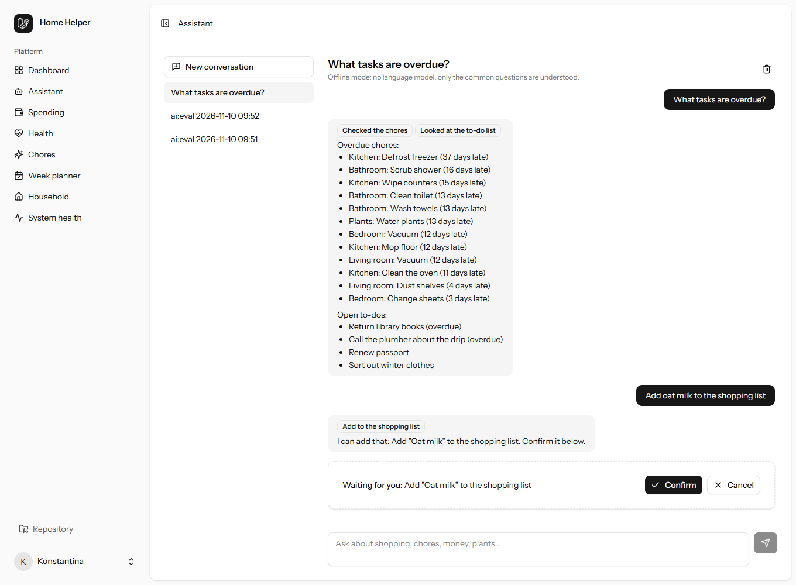
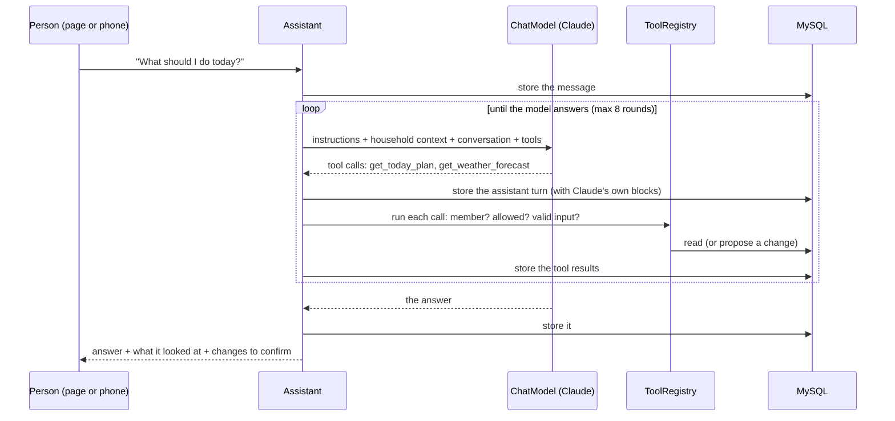

# The assistant

Phase 2 ([phase-2.md](phase-2.md)), with memory added in Phase 3 ([memory.md](memory.md)): Home Helper answers questions about the household in plain language, using the household's own data, and proposes changes that only happen once you confirm them.

> **What do I need to buy?** · **How much did I spend this month?** · **What tasks are overdue?** · **Which plants need attention?** · **What should I do today?**



*The page in offline mode on the demo household: an answer with what it looked at, and a proposed change waiting for Confirm. With Claude the answers are written by the model from the same tool results.*

## The model

**Claude Opus 5.5** (`claude-opus-5-5`) through the official Anthropic PHP SDK (`anthropic-ai/sdk`). Why:

- **Tool use is the whole job.** Every answer comes from calling the household's data, often several tools at once ("what should I do today" touches chores, the calendar, to-dos, plants and bills). That needs a model that picks the right tools, calls independent ones in parallel, and says "I don't know" instead of guessing when a tool has nothing.
- **An official PHP SDK**, so the server stays one Laravel app: no Python side-service, no hand-rolled HTTP.
- **Prompt caching and server-side refusal fallback** are request options, not infrastructure.

It sits behind an interface, so the model is a setting:

| `AI_PROVIDER` | What answers | For |
|---|---|---|
| `claude` | Claude through the Anthropic API (needs `ANTHROPIC_API_KEY`) | Real use |
| `offline` | `OfflineChatModel`: keywords choose the tools, fixed templates write the answer. No model, no key, no cost | Running it locally without a key, demos. It understands the common questions only and has no memory |

`AI_MODEL` (default `claude-opus-5-5`) and `AI_EFFORT` (default `medium`; thinking depth and spend, `low` to `max`) tune Claude.

## How a turn works



- `app/Ai/Assistant.php`: the loop. One conversation answers one message at a time (a cache lock; a second message meanwhile is `409 conversation_busy`).
- `app/Ai/ChatModel.php`: the interface; `Providers/ClaudeChatModel.php` and `Providers/OfflineChatModel.php`.
- `app/Ai/Tools/`: the tools, the registry, and the context each tool runs in.
- `app/Ai/Presenter.php`: the transcript as people see it (tool results and raw model blocks stay on the server).

### Conversation history and context

Everything is stored as it happens in `ai_messages` (user, assistant, tool_results, event), and every turn sends the conversation, so follow-ups work ("and how much of it?"). Since Phase 3 a long conversation is sent as a summary of its older part plus its newest messages, and the household's remembered facts are in the context ([memory.md](memory.md#conversation-summaries)). The request is built so it stays cacheable:

1. **Tools**, in a fixed order (sorted by name).
2. **Instructions** (`Assistant::INSTRUCTIONS`): the same for everyone. Prompt-cache breakpoint here.
3. **Context**: household name, currency, time zone, who is asking and their role, today's date. Changes daily, so it sits after the breakpoint.
4. **The conversation**, with an automatic cache breakpoint at its end, so each turn re-reads the earlier ones at the cache price.

Claude's replies are stored twice: as neutral blocks (text, tool calls) for the screen and other providers, and **as Claude's own content blocks**, which are sent back byte for byte. Thinking blocks and their signatures stay exactly as written, which the model needs to keep its reasoning across tool calls. Earlier turns always render the same way (append-only), so nothing invalidates the cache or the thinking.

Things that happen between turns (you confirmed or declined a change) are stored as `event` messages and reach the model as "[Home Helper] The person confirmed …", so it never claims something is done that wasn't.

A conversation holds up to 200 messages; then it asks you to start a new one.

## Tools

Twenty tools, registered in `app/Providers/AiServiceProvider.php`. `GET /api/households/{h}/assistant/tools` lists them.

| Area | Tool | Reads / changes |
|---|---|---|
| Household | `get_household_overview` | members and roles, counts, whether weather is available |
| | `get_today_plan` | **"What should I do today?"**: chores due and overdue, today's events, to-dos due, plants to water, bills and appointments in the next 3 days, shopping day |
| Tasks | `list_todos` | open/done to-dos, overdue first |
| | `list_overdue_chores` | **"What tasks are overdue?"**: overdue and slipping chores (`OverdueChoresQuery`, `SlippingChoresQuery`) |
| | `list_upcoming_events` | the calendar for the next N days |
| | `add_todo` ✋ | adds a to-do |
| | `complete_todo` ✋ | marks a to-do done |
| | `mark_chore_done` ✋ | records a chore as done now |
| Shopping and kitchen | `get_shopping_list` | **"What do I need to buy?"**: the list, an estimated total, the usual shopping day, and what will run out within a week but isn't on the list (`RunOutQuery`) |
| | `get_kitchen_inventory` | low, empty and expiring items; when staples run out |
| | `add_shopping_item` ✋ | puts an item on the list (refuses one that's already on it) |
| | `check_off_shopping_item` ✋ | ticks an item off |
| Money (read only) | `get_spending_summary` | **"How much did I spend this month?"**: totals by category against budgets, last month, and where the month is heading (`BudgetForecastQuery`) |
| | `list_expenses` | individual expenses by date, category or text |
| | `get_upcoming_bills` | recurring bills by their next date, and one-off bills and renewals |
| Plants, weather, upkeep | `get_plant_care_today` | **"Which plants need attention?"**: watering with amounts, other care, weather warnings, the coming week (`PlantCareService::today`) |
| | `list_plant_alerts` | open alerts from the hourly plant check |
| | `get_weather_forecast` | the next 24 hours at home (Open-Meteo, cached) |
| | `list_home_maintenance` | renewals, appointments, supplies running out |
| | `log_plant_care` ✋ | records watering, fertilizing, … and moves the next date |

✋ = changes data, so it needs your confirmation.

The tools reuse the same queries and services as the API and the dashboard, so the assistant, the phone and the web page always agree. Results are kept small (names, dates, amounts), because the model reads every byte.

## Permissions, validation and confirmation

Every tool call goes through `ToolRegistry`, in this order:

1. **The tool exists.** An unknown name comes back as an error listing the real ones.
2. **You're a member of the household**, checked on every call, not just when the conversation started.
3. **Writes are allowed** (`AI_ALLOW_WRITES`, default on) and **the module's policy allows it** (the same `create`/`update` policies as the API).
4. **The input is valid**: Laravel validation rules per tool. Every id must be a live row **of this household** (`exists` scoped by `household_id`), so a made-up or foreign id fails like a typo.
5. **A read runs now. A write doesn't**: it becomes an `ai_pending_actions` row with a sentence of what will happen ("Add "Oat milk" (2) to the shopping list"). Nothing changes until you press **Confirm** under the answer. On Confirm, steps 2–4 run again (you may have left the household, the item may already be on the list), and only then does it run, in a transaction.

Proposals expire after 30 minutes. Failures at any step go back to the model as an error result it can explain or fix, never as a crash or a stack trace.

What the assistant can't do, on purpose: add or change expenses, bills or budgets; delete anything; see anyone's personal health logs (food, water, sleep, workouts, weight). There are no tools for them.

Conversations are private: another member gets 404 for your conversation and your pending actions.

### Prompt injection

Tool results contain text household members typed (item names, notes, to-do titles). The instructions tell the model to treat it as data. The real protection is structural: the model can only reach this household's data, can't call anything outside the tool list, and can't change anything without the person pressing Confirm on a sentence that describes the change.

## Cost and limits

- **10 messages a minute** per person (`throttle:ai`) and **200 a day** (`AI_DAILY_MESSAGES`), across conversations.
- **At most 8 model → tools rounds** per message.
- Tokens are stored per assistant message (`input_tokens`, `output_tokens`, `cache_read_tokens`, `cache_write_tokens`), so spend can be measured per household.
- The instructions, tool definitions and earlier turns are cached; each new turn pays full price only for what's new.

## Privacy

With `AI_PROVIDER=claude`, the question and the tool results needed to answer it (item names, amounts, chore names, plant names, dates, first names of members) are sent to Anthropic's API. Personal health logs never are: no tool reads them. With `AI_PROVIDER=offline` nothing leaves the server.

## API

All under `/api/households/{household}/assistant`, with a token, for members only.

```http
GET    tools                                   what it can do, and which tools need confirmation
GET    conversations                           yours, newest first
POST   conversations          {message?}       start one (and ask the first question)      → 201
GET    conversations/{id}                      messages and actions
POST   conversations/{id}/messages {message}   ask; answers when the turn is done
DELETE conversations/{id}
POST   actions/{id}/confirm                    do it (409 action_closed if already decided)
POST   actions/{id}/decline
```

```json
{
  "conversation": { "id": "01K…", "title": "What do I need to buy?", "updated_at": "…" },
  "messages": [
    { "id": 41, "role": "user", "text": "What do I need to buy?", "tools": [] },
    { "id": 42, "role": "assistant", "text": "Four things: bananas, coffee, milk and bin bags…", "tools": ["Read the shopping list"] }
  ],
  "actions": []
}
```

Errors use the API's format ([api.md](api.md#errors)): `503 ai_unavailable` (with `retryable`; your message is kept), `409 conversation_busy`, `422 conversation_full`, `429 daily_limit_reached`, `409 action_closed`.

## The page

`/assistant` (`resources/js/pages/assistant.tsx`): your conversations on the left, the chat on the right. An empty conversation offers the five questions as buttons. Each answer shows what it looked at ("Read the shopping list", "Checked the plants"), and a proposed change appears as a card with **Confirm** and **Cancel**. Enter sends, Shift+Enter adds a line. The answer's text is rendered from React elements (paragraphs, lists, bold), never as HTML.

## Evaluating it

```bash
php artisan ai:eval                      # AI_PROVIDER from .env
php artisan ai:eval --provider=offline   # no key, no cost
```

Asks nine questions in one conversation on the demo household (the five above, then weather for the balcony plants, bills and budget together, the kitchen against the list, and "add oat milk"), prints each answer, the tools it used and the time, and checks that the right tools were called. With Claude it is about nine paid requests, a few cents at medium effort. The conversation is kept, so you can read it on `/assistant`.

**Run so far:** only with `--provider=offline` (9/9). It has **not been run against the real model yet**: there was no API key in the environment it was built in. Set `ANTHROPIC_API_KEY` and `AI_PROVIDER=claude`, then run `php artisan ai:eval`.

## Tests

`tests/Feature/Ai`, 64 tests:

- `ClaudeChatModelTest`: the real SDK with a fake HTTP client underneath. The exact request on the wire (model, effort, fallback beta, cache breakpoints, tools), thinking blocks replayed with their signatures, tool results, refusals, and a bad key or bad request not being retried.
- `ToolRegistryTest`: unknown tools, membership, validation, ids from another household, proposals, confirm, re-checking on confirm, expiry, decline, writes switched off, a tool that throws.
- `ToolsTest`: each tool's answer against rows made for it, with exact numbers.
- `AssistantTest`: the loop, history, parallel calls, cut-off replies, the round limit, busy, daily and full limits, the model being down.
- `AssistantApiTest`, `AssistantPageTest`: the endpoints and the page, privacy between members, errors, the rate limit.
- `ConversationsTest` (day 28): whole conversations on the six-month demo household across modules ("what should I do today" → "and the money?"; "what do I need to buy" → "add coffee" → Confirm → it's on the list; plants → "I watered it"), checked against the database; and `ai:eval --provider=offline` passing 9/9.

The model in these tests is scripted (`tests/Support/ScriptedChatModel.php`); what they prove is everything around it. `ai:eval` is how to check the model itself.

## Adding a tool

1. A class in `app/Ai/Tools/<Area>/` extending `Tool`: `name()`, `label()`, `description()` (for the model: what it returns, when to use it), `schema()` and `rules()` (keep them in step), `run()`. For a change: `writes(): true`, `authorize()` with the module's policy, and `describe()` for the Confirm button.
2. Add it to `AiServiceProvider::TOOLS`.
3. A test in `ToolsTest` with exact numbers.
