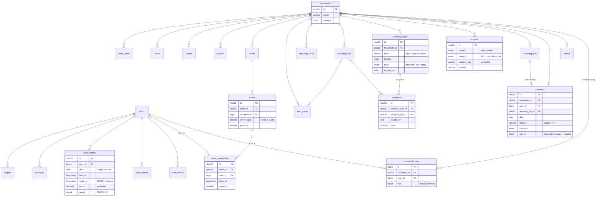

# Database design

Every row belongs to a **household**. Shared data (money, kitchen, shopping, chores, planner) has a `household_id`; personal logs (food, water, sleep, workouts, weight) also have a `user_id`.

Column-level diagrams for every table, generated from the live schema: **[database.md](database.md)**. This page explains the design choices behind them.

Every synced table also has `created_at`, `updated_at`, `deleted_at` (millisecond precision) and an index on `(household_id, updated_at)` for the sync pull in Phase 4.

## Design decisions

- **ULID primary keys** (`char(26)`). The phone creates rows while offline, so it has to make ids itself. ULIDs sort by time, so new rows land at the end of the index. Users keep `bigint` ids from the Laravel starter kit, because only the server creates them.
- **Arrays became tables.** On the phone each kitchen item holds a `purchases: string[]` and each chore a `lastDone`. Here, `purchases` and `chore_completions` are their own tables, so "when was this last bought?" or "who did most of the chores this month?" is a query, not a loop in JavaScript.
- **Every price is kept.** The phone remembers only the last price per item; `item_prices` keeps each one, so price changes can be tracked over time (Phase 3).
- **`DECIMAL(10,2)` for money**, `DATE` for calendar days, `TIMESTAMP(3)` for moments. Food and water keep both a `date` (the local day) and a timestamp, so a meal never moves to another day because of time zones.
- **Unique keys that work with soft deletes.** `(household_id, name)` on inventory would stop you adding "Milk" again after deleting it, because the deleted row is still there. These tables have a generated column `alive` (1 while live, NULL once deleted) at the end of the unique key, and MySQL never treats two NULLs as equal.
- **One overall budget per period.** `budgets.category` is NULL for the whole budget, and for the same NULL reason the unique key uses a generated `category_key = coalesce(category, 'all')`.
- **CHECK constraints** catch impossible values in the database itself, not only in validation: no negative amounts, bills on day 1–28, sleep quality 1–5, waking after going to bed, and so on. MySQL also works out `sleep_entries.hours` from the two times, so it can't disagree with them.
- **Delete rules.** Deleting a household cascades to all its data. Deleting a user keeps the household's money and chores (`user_id` becomes NULL), but deletes that user's personal food, sleep and weight logs.
- **Enums in one place.** PHP enums (`app/Enums`) feed both the migration `enum` columns and the model casts.
- **`household_id` is never mass-assignable.** Rows get their household from the relation (`$household->expenses()->create(...)`), never from request input.

