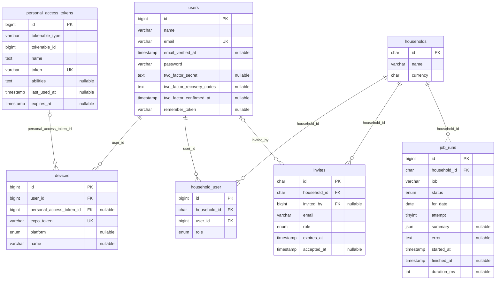
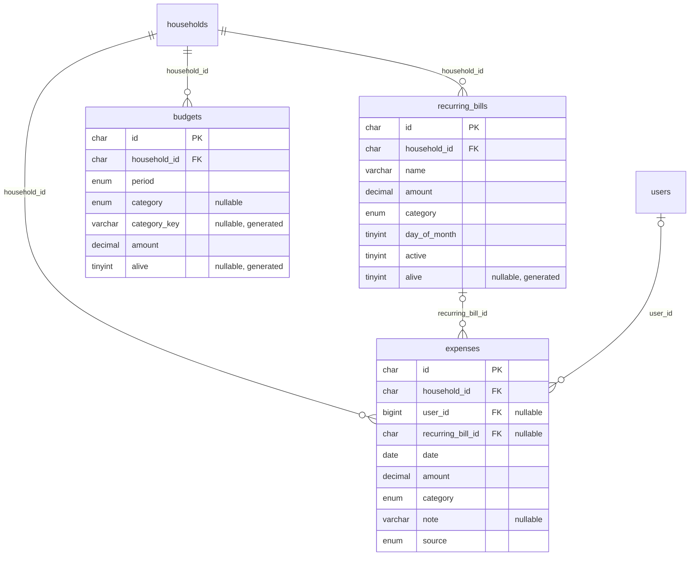
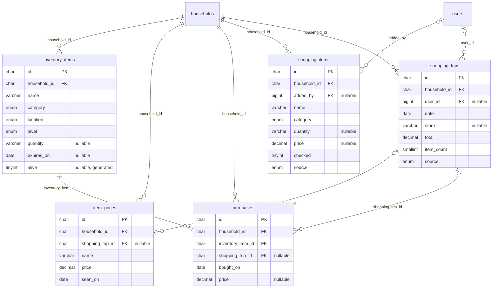
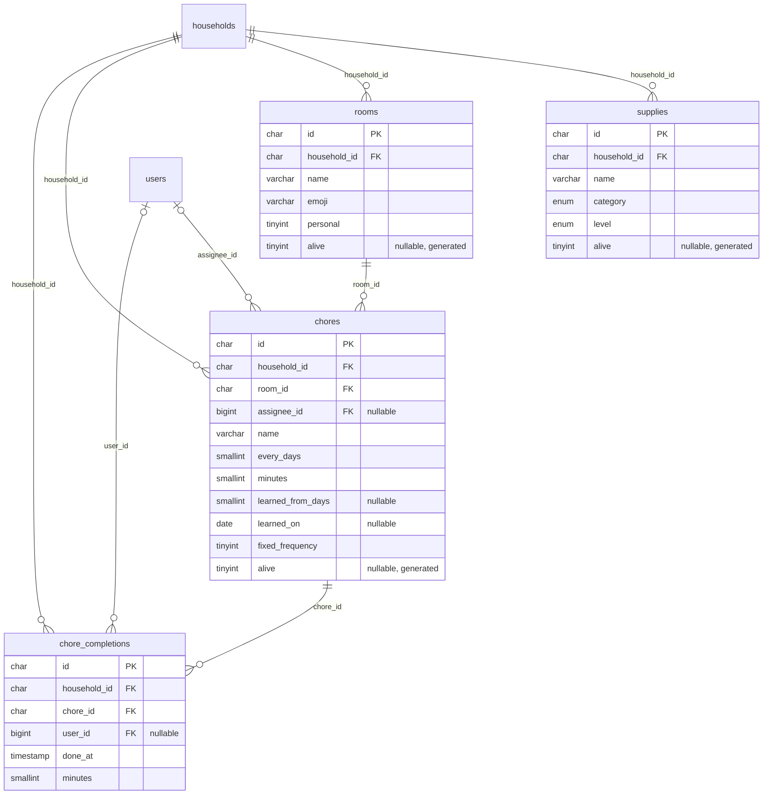
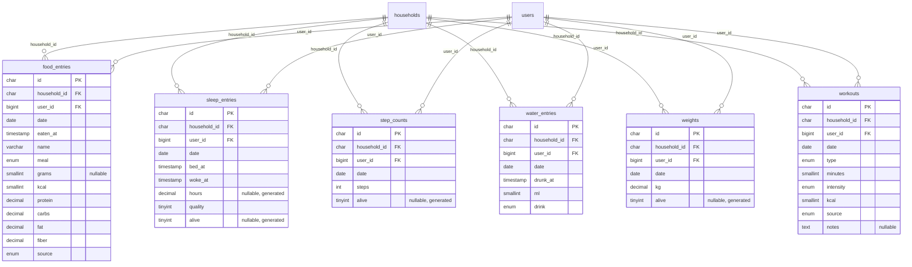
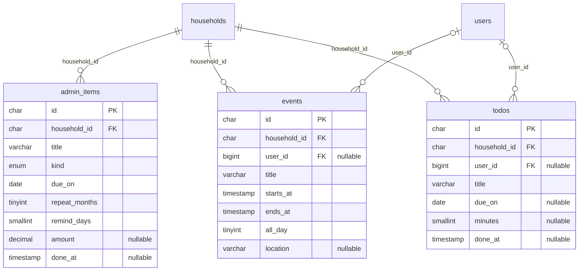

# Database

<!-- Generated by `php artisan docs:schema` from the live MySQL schema. Do not edit by hand. -->

Every household table has a ULID `id`, `household_id`, millisecond `created_at`/`updated_at`/`deleted_at` and a `synced_at` cursor for phone sync (left out of the module diagrams below to keep them readable). Design notes: [database-design.md](database-design.md).

## Overview

```mermaid
erDiagram
    chores ||--o{ chore_completions : "chore_id"
    users |o--o{ chore_completions : "user_id"
    users |o--o{ chores : "assignee_id"
    rooms ||--o{ chores : "room_id"
    personal_access_tokens |o--o{ devices : "personal_access_token_id"
    users ||--o{ devices : "user_id"
    users |o--o{ events : "user_id"
    recurring_bills |o--o{ expenses : "recurring_bill_id"
    users |o--o{ expenses : "user_id"
    users ||--o{ food_entries : "user_id"
    households ||--o{ household_user : "household_id"
    users ||--o{ household_user : "user_id"
    households ||--o{ invites : "household_id"
    users |o--o{ invites : "invited_by"
    shopping_trips |o--o{ item_prices : "shopping_trip_id"
    households ||--o{ job_runs : "household_id"
    inventory_items ||--o{ purchases : "inventory_item_id"
    shopping_trips |o--o{ purchases : "shopping_trip_id"
    users |o--o{ shopping_items : "added_by"
    users |o--o{ shopping_trips : "user_id"
    users ||--o{ sleep_entries : "user_id"
    users ||--o{ step_counts : "user_id"
    users |o--o{ todos : "user_id"
    users ||--o{ water_entries : "user_id"
    users ||--o{ weights : "user_id"
    users ||--o{ workouts : "user_id"
```

## Households and accounts

## Money

## Shopping and kitchen

## Chores

## Health logs

## Planner and life admin

