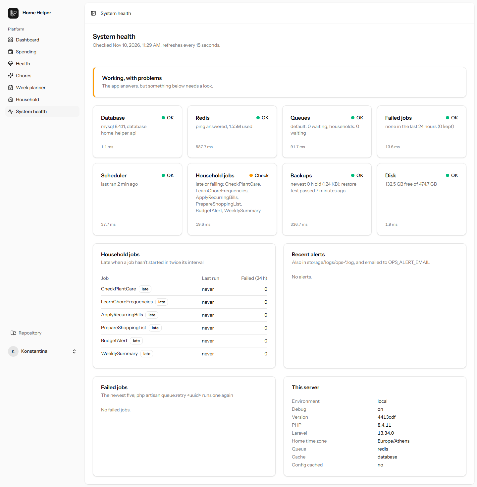

# Operations: logs, queues, alerts and health

Days 9, 10 and 13 of [Phase 1](phase-1.md). How to tell whether the server is working, and what it tells you when it isn't.

## Logs

| Channel | File | For |
|---|---|---|
| `json` (production: `LOG_STACK=json`) | `storage/logs/laravel.json-YYYY-MM-DD.log`, 14 days | Everything, one JSON object per line, for a log shipper |
| `ops` | `storage/logs/ops-YYYY-MM-DD.log`, 90 days | Alerts only (below) |
| `single` (local default) | `storage/logs/laravel.log` | Development |

Every line written during a request carries, in `extra`/`context`:

- `request_id`: the one in the `X-Request-Id` header and in every API error body. A phone's error report quotes it; `grep` the log for it.
- `user_id`: set when the session or the token is authenticated (`Authenticated` and Sanctum's `TokenAuthenticated` events).
- `household_id`: set when a route has `{household}`.

This is Laravel's `Context`, so it travels **into queued jobs** too: a job's log lines carry the request id of the request that queued it.

**Reported exceptions** also get `method`, `route` and `path`. The same exception from the same line is reported once per request (`dontReportDuplicates`). 4xx errors (validation, 404, 401, 403) aren't reported: they're the client's mistake, not the server's.

**Slow queries**: one query over `LOG_SLOW_QUERY_MS` (500 ms) is logged as a warning with its SQL, without the bindings (they can be personal data).

## Queues

Redis, two queues:

| Queue | Jobs |
|---|---|
| `default` | Mail, notifications, anything else |
| `households` | The six household jobs, one per household per run |

Workers take `default` first: `php artisan queue:work redis --queue=default,households` (Supervisor config in `ops/deploy/`). Settings that matter (`config/queue.php`):

- `retry_after` **180 s**, above the longest job's 120 s timeout. It was 90, which could start a long job twice.
- `after_commit`: a job queued inside a transaction waits for the commit.
- `block_for` 5 s: workers wait on Redis instead of polling it.
- Household jobs: 3 tries, 60 s then 300 s backoff, each run logged in `job_runs`.

**Failed jobs** stay in `failed_jobs` for 14 days (`queue:prune-failed`, daily).

```bash
php artisan queue:failed              # list
php artisan queue:retry all           # or one uuid, from the health page
php artisan queue:forget <uuid>
```

## Alerts

`App\Ops\Alerts::raise()` writes to the `ops` log, keeps the last 20 for the health page, and emails `OPS_ALERT_EMAIL`. The same alert key is emailed **at most once per 15 minutes** (`OPS_ALERT_COOLDOWN_MINUTES`), so a job failing for every household sends one email, not one per household. The email is sent immediately, not queued, because the queue may be what's broken.

| Alert | Raised by |
|---|---|
| `job-failed:BudgetAlert` (and the other household jobs) | `HouseholdJob::failed()`, after the last try, with the household and the error |
| `job-failed:<Class>` | Any other job that fails for good (`Queue::failing`) |
| `queue-busy:redis:<queue>` | `queue:monitor` (every minute) when a queue holds more than `QUEUE_MAX_WAITING` (100) |
| `exception:<hash>` | A reported server error, keyed by class + file + line |
| `backup-failed`, `restore-test-failed` | `db:backup`, `db:restore-test` |

## Health

### `GET /api/health`, for an uptime monitor

Public, 30 / min per IP. **200** while the app works (`ok` or `degraded`), **503** when it's `down` (the database is unreachable). Anyone gets each check's status; a token of an admin (`OPS_ADMIN_EMAILS`) also gets summaries, timings, details and server facts.

```json
{
  "status": "degraded",
  "checked_at": "2026-11-10T11:30:02+02:00",
  "checks": {
    "database": { "status": "ok" },
    "redis": { "status": "ok" },
    "queues": { "status": "ok" },
    "failed_jobs": { "status": "ok" },
    "scheduler": { "status": "fail" },
    "household_jobs": { "status": "warn" },
    "backups": { "status": "ok" },
    "disk": { "status": "ok" }
  }
}
```

`/up` (Laravel's) stays as the plain "PHP answers" check for a load balancer.

### `/system/health`, for an admin



The same checks with details, refreshing every 15 seconds: household jobs with their last run and failures, the newest failed jobs with their error, the recent alerts, and the server (environment, debug, version, PHP, Laravel, queue and cache drivers, config cache). Linked in the sidebar for admins only; anyone else gets 403.

| Check | ok | warn | fail |
|---|---|---|---|
| Database | `select 1` answers | | unreachable (overall **down**) |
| Redis | `PING` answers | | unreachable |
| Queues | each under `QUEUE_MAX_WAITING` | one is over, or `QUEUE_CONNECTION=sync` | |
| Failed jobs | none in 24 h | some in 24 h | |
| Scheduler | heartbeat under 5 min old | | older, or never (no cron / `schedule:work`) |
| Household jobs | each started within twice its interval | one is late or failed in 24 h | |
| Backups | newest under 26 h, last restore test passed | restore test failed or never ran | no backup, or the newest is too old |
| Disk | over 1 GB free | | under `HEALTH_DISK_MIN_FREE_MB` |

The scheduler check works through a heartbeat: `routes/console.php` writes a timestamp to the cache every minute.
