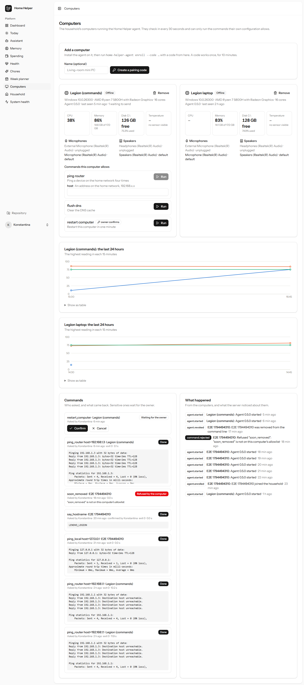

# Phase 5: The C++ local agent

**Goal:** give Home Helper access to the physical computers in the house and their surroundings.
**Deliverable:** a local agent that connects your physical devices to Home Helper.
**Rule:** no unrestricted shell for the AI: an allowlist, authentication, and confirmation for
sensitive operations.
**Done:** 2026-11-12. The agent: [`agent/`](../agent/README.md). The server side: [agents.md](agents.md).

| Day | Task | Result |
|---:|---|---|
| 57 | A separate C++ project | `agent/`: a self-contained CMake project (C++20) inside this repository, so the agent, the API it talks to and the dashboard change in one pull request; `git subtree split --prefix agent` makes it its own repository at any time. [Design](../agent/docs/design.md): goals, non-goals (no remote shell, no recording), trust model |
| 58 | CMake, structure, logging | Pinned dependencies (spdlog, nlohmann/json, Catch2 by URL + SHA-256; Monocypher vendored), a core library the tests link, spdlog with a rotating file, `/W4` and `-Wall -Wextra`, sanitizer option, CI on Linux and Windows plus ASan/UBSan |
| 59 | Secure communication | HTTPS only (WinHTTP on Windows, libcurl elsewhere). Every request **HMAC-SHA-512 signed** (method, path, timestamp, nonce, agent, body hash); every response signed back over the request's nonce, and the agent ignores an unsigned success. Shared test vectors generated by PHP and checked by both test suites. [Protocol](../agent/docs/protocol.md) |
| 60 | Registration and authentication | The owner makes a one-time 8-character pairing code (10 min, HMAC stored, rate-limited); `enroll` trades it for an id and a 256-bit secret, stored **DPAPI-encrypted with an ACL** on Windows and 0600 on Linux, and encrypted with `APP_KEY` on the server. Middleware checks clock skew and replayed nonces |
| 61 | Heartbeat and status | Every 30 s: version, uptime, readings, outbox size. Latest readings on the agent row, one chart row a minute; online means seen within four heartbeats |
| 62 | Local monitoring | CPU, memory, disks, temperature. Windows: `GetSystemTimes`, `GlobalMemoryStatusEx`, fixed drives, ACPI thermal zones over WMI. Linux and the Pi: `/proc`, `statvfs`, hwmon and thermal zones, parsers tested with a fake `/sys` |
| 63 | Rest and review | Pushed, CI green on both platforms first time; a manual run against the real app. Fixed PHPStan and generated-docs drift and a stale git commit in the binary. [Review](../agent/docs/review-day-63.md) |
| 64 | Microphones and audio devices | Windows Core Audio (names, default device, active/unplugged) and ALSA on Linux. **Listed, never opened.** Sent in the inventory with the system, disks and allowlist; plugging in and unplugging become events |
| 65 | Commands with an explicit allowlist | The allowlist lives on the computer: absolute programs (shells, script hosts and `.bat`/`.cmd` refused), fixed arguments, parameters that fill one whole argument and must match a pattern, never an option. Started without a shell, in a Job object / process group, with timeouts and an output cap. Sensitive commands run only after the owner confirms. The assistant can only *propose* a non-sensitive allowlisted command, which the person confirms. [Commands](../agent/docs/commands.md) |
| 66 | Event reporting | Threshold events with hysteresis (CPU, memory, disk, temperature), audio, refused commands, start and stop. A durable on-disk outbox for events and results; resends recognised by id; warnings pushed to phones once an hour at most |
| 67 | Configuration and service startup | `agent.json` with a JSON Schema and "every problem at once" checking. A Windows service (LocalSystem, delayed start, restart on failure, only the privileges it uses, locked-down folders) and a hardened systemd unit. [Configuration](../agent/docs/configuration.md), [service](../agent/docs/service.md) |
| 68 | Reconnect and offline | Exponential backoff with jitter (5 s → 2 min), offline logged once, `agent.reconnected` with how long; the server records `agent.offline` / `agent.online`; commands for an offline computer expire |
| 69 | Secure updates and versions | Releases **signed with Ed25519**; the agent checks the signature against the key in its *own* config before downloading, never downgrades, installs only after the owner presses Install, verifies again before swapping, keeps the old binary for rollback. Every version change is an event. [Updates](../agent/docs/updates.md) |
| 70 | Test C++ ↔ Laravel ↔ dashboard | The Computers page. `agent/scripts/e2e.sh`: the real agent against the real app on MySQL, from pairing to removal, passing on Windows and run on Linux in CI for every pull request |

## In numbers

- **C++:** about 6,400 lines in `agent/src` and `agent/apps`, 2,100 of tests: **105 Catch2 tests** (Windows MSVC, Linux GCC, Clang ASan/UBSan), plus the end-to-end script.
- **Laravel:** 6 migrations, 7 agent endpoints, 8 dashboard routes, 2 assistant tools, 6 artisan commands, 1 scheduled check. Pest: 536 → **599**; Vitest: 46 → **53**.

## Security, in one table

| Concern | Answer |
|---|---|
| Can the AI run anything it likes? | No. It can name a command from a computer's own allowlist, fill its declared parameters, and the person must confirm. Sensitive commands are refused to it outright. |
| Can the server run anything it likes? | No. The agent checks every request against its local allowlist; there is no endpoint, field or tool that carries a command line. |
| Can someone on the network impersonate the server or replay a request? | No: TLS, signed requests and responses, nonces, a ±5 min window. |
| Can a compromised server push a malicious update? | No: releases must be signed by a key whose public half is in each computer's config, and the owner must press Install. |
| A stolen laptop disk? | The secret is DPAPI-encrypted to that machine; remove the computer on the dashboard and it stops working at once. |

## Not done yet

- Code signing (Authenticode) of the Windows binary itself, beyond the release signature.
- Packages (an MSI, a `.deb`) instead of the install scripts.
- Per-member permissions for individual commands (today: members run non-sensitive ones, the owner confirms sensitive ones).
- macOS: the code compiles for it in principle, but there is no monitor or service for it.
- Audio *use*: the agent lists microphones; using one for the voice assistant is a later phase.

## The Computers page

