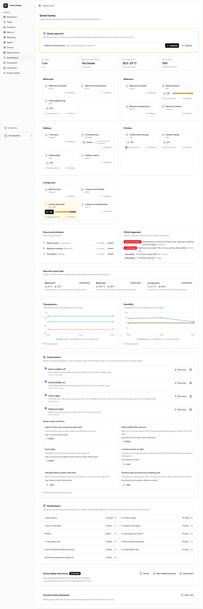

# Smart home

Home Helper sees and controls the household's lights, plugs, locks and sensors through
**Home Assistant**. Home Assistant talks to the devices (Zigbee, Wi-Fi, Tuya/Smart Life,
BroadLink and thousands more); Home Helper adds the household: members and rooms, approvals,
automations that know who did what, the assistant and the phones. Built in
[Phase 6](phase-6.md).

Setup and the Raspberry Pi: [smart-home/setup.md](smart-home/setup.md). How it was tested
against a real Home Assistant: [smart-home/testing.md](smart-home/testing.md).

## Pieces

| | |
|---|---|
| `app/SmartHome/HomeAssistant` | the REST client: `/api/config`, `/api/states`, service calls, templates. Every failure is a `HomeAssistantError` with a kind (`unreachable`, `unauthorized`, `rejected`, `not_found`, `error`). 5 s timeout, 3 s to connect, no redirects |
| `Connections` | connect, check, rotate the webhook secret; the connection's status follows the last real call |
| `Discovery`, `StateChanges` | sync every state, apply one state (webhook, sync or reply), announce real changes once |
| `Import`, `Capabilities`, `DeviceKind` | which devices Home Helper shows, what each can do |
| `Control`, `Sensitivity` | every switch, dim, lock and unlock; approvals |
| `Readings`, `Comfort`, `Openings`, `HomeEvents`, `Notifications` | sensors, doors and windows, the event log, pushes |
| `Automation\RuleValidator`, `RuleEngine`, `Templates` | automations and ready-made workflows |
| `app/Ai/Tools/SmartHome/*` | `get_smart_home`, `control_device` |

Tables: `smart_home_connections`, `smart_devices`, `smart_home_actions`,
`smart_device_readings` (30 days), `smart_home_events` (60 days), `automation_rules`,
`automation_runs` ([diagram](database.md)).

## Connecting

The owner enters Home Assistant's address and a long-lived access token on the Smart home
page (or `php artisan smart-home:connect`). The token is checked against `/api/config` before
anything is saved and stored encrypted. Addresses are normalised; paths, credentials and other
schemes are refused. One connection per household; connecting again replaces it.

Connecting also creates a **webhook secret**, shown once, for Home Assistant's
`secrets.yaml`. The secret is stored hashed and can be rotated.

## Discovery and sync

`smart-home:sync` runs every minute: it reads every state, finds new devices, marks removed and
unavailable ones, and matches Home Assistant **areas** to the household's rooms by name. Only
the domains Home Helper understands are kept: `light`, `switch`, `sensor`, `binary_sensor`,
`lock`, `cover`, `climate`, `fan`. The sync is also the fallback when a pushed change was lost.

## State changes

[`ops/home-assistant/config/packages/home_helper.yaml`](../ops/home-assistant/config/packages/home_helper.yaml)
makes Home Assistant POST each change to `/api/smart-home/v1/states` as it happens
(`Authorization: Bearer <connection id>.<secret>`). A door opening reaches Home Helper in
about a second, without waiting for a sync.

The webhook, the sync and the reply to a button press all go through one method,
`StateChanges::apply`:

- Home Assistant's `last_changed` decides. An older state never overwrites a newer one, also
  when the newer one had the same state. Pushes are sent in parallel, so they can arrive out of
  order ([day 84](smart-home/testing.md#what-the-real-home-assistant-found)).
- Only a different state fires `DeviceStateChanged`; attribute changes are just saved.
- Only small attributes are kept (40 keys, 500 bytes each).
- An entity Home Helper doesn't know yet waits for the next sync.

## Importing

Discovery finds everything; the owner chooses what Home Helper shows. Capabilities come from
Home Assistant's attributes (`supported_color_modes` for dimming, `device_class` for doors,
windows and motion, units for temperature and humidity). Removing a device removes it from
Home Helper, not from Home Assistant.

## Controls

| Kind | Actions |
|---|---|
| light | `turn_on`, `turn_off`, `toggle`, `set_brightness` (1-100 %, sent as `brightness_pct`) |
| switch | `turn_on`, `turn_off`, `toggle` |
| lock | `lock`, `unlock` |

Every action goes through `App\SmartHome\Control`, from the dashboard, the phone, an
automation or the assistant. It checks permissions, that the device is imported and
answering, and that the device can do the action. One `smart_home_actions` row records
who, what, from where and what happened. Home Assistant's reply updates the stored state at
once.

## Sensitive actions

Some actions shouldn't happen just because someone pressed a button: unlocking the front door,
switching on the coffee machine or a heater when nobody is home.

- **Sensitive from the start:** every lock, climate devices, garage doors and gates, and
  switches whose names suggest heat or water (coffee, kettle, oven, heater, iron, boiler,
  washing machine...). The owner can mark any other device. A lock can't be unmarked.
- **Only the risky direction** waits: unlocking, switching on, opening. Locking up and
  switching off never wait, so anyone or any rule can make the house safer.
- **The owner asking is the approval.** A member, an automation or the assistant asking
  creates an `awaiting_approval` action, and the owner gets a push. The owner approves or
  declines on the page or from the phone. Before it runs, the device is checked again.
  Unanswered requests expire after 10 minutes.
- **The assistant can never unlock directly**, even for the owner. It can only create the
  request.

## Temperature and humidity

One reading per sensor per minute at most (the latest value), and a point every 15 minutes for
a sensor that doesn't change. Charts per room over 24 hours, comfort per room (18-24 °C,
40-60 %), dew point, and alerts when a room gets very humid (> 70 %) or cold (< 18 °C).

## Doors and windows

Door, window and motion sensors become events in the log, with how long something was open.
`smart-home:check-openings` (every minute) warns once when a door has been open for
10 minutes or a window for 30. A sensor going `unavailable` and back (a flat battery, a Home
Assistant restart) is never an opening.

## Events

`smart_home_events` is the house's log: openings, alerts, devices and Home Assistant going
quiet and coming back (`hub.offline` / `hub.online`, once per outage), failed automations and
approval requests. The automations and the notifications listen to it.

## Notifications

| Event | Default |
|---|---|
| A door or window opens | at night (23:00-06:00) |
| Left open, very humid, cold, a device stops answering, Home Assistant stops answering, an automation fails | always |
| Motion | never |
| Something needs your approval | always, to the owner only, never throttled |

The owner changes these per type on the page. The same thing is pushed at most once every
15 minutes.

## Automations

A rule is **trigger → conditions → actions**, in fixed shapes checked on every save
(`RuleValidator`):

| | |
|---|---|
| Triggers | a device changes state, a sensor crosses a value, an event in the log, a time of day |
| Conditions (up to 5) | time window (wraps midnight), sun up/down at the household's location, days, a device's state, a sensor value |
| Actions (1-5) | a device action through `Control`, a push to the household |

Every match is an `automation_runs` row, including those a condition or the cooldown stopped,
so "why didn't the light come on?" has an answer. Rules act through `Control` with source
`rule`, so they can't do anything a person couldn't, and their sensitive actions wait for the
owner. Loops are stopped by a depth limit within one chain and by each rule's cooldown across
chains.

## First workflows

Six ready-made workflows fill themselves in from the household's own devices, matched by kind
and name: *Light on when you come home after dark*, *Dehumidifier after showers*, *Good night*,
*A window opens at night*, *Hall light follows motion after dark*, *Window open and the room is
getting cold*. The page says which devices each would use, or what's missing.

## Who can do what

| | Owner | Member | Assistant |
|---|---|---|---|
| See devices, rooms, events | ✓ | ✓ | ✓ (`get_smart_home`) |
| Switch everyday devices | ✓ | ✓ | proposes it; the person confirms in the chat |
| Sensitive action | ✓ directly | asks; the owner approves | asks; the owner approves |
| Connect, import, mark sensitive, edit automations, notifications | ✓ | ✗ | ✗ |
| Approve or decline | ✓ | ✗ | ✗ |

## The assistant

`get_smart_home` gives the assistant the rooms, devices, states and which actions need the
owner. `control_device` switches one device by name. Like every write tool, it waits for the
person to confirm in the chat, then goes through `Control`. Unlocking always becomes an
approval request.

## API

| | |
|---|---|
| `GET  /api/households/{h}/smart-home` | imported devices and the house summary |
| `POST /api/households/{h}/smart-home/devices/{d}/actions` | `{action, brightness?}`: 200 done, 202 waiting for the owner, 422 refused |
| `POST /api/households/{h}/smart-home/approvals/{a}/approve` | owner only |
| `POST /api/households/{h}/smart-home/approvals/{a}/decline` | owner only |
| `POST /api/smart-home/v1/states` | Home Assistant's webhook (connection secret, not a user token) |

Control and approvals are rate-limited per user (`smart-home-control`), the webhook per
connection.

## The test home

A real Home Assistant in Docker with simulated devices: 3 lights, 3 plugs and switches, temperature and
humidity in 3 rooms, 2 doors, a window, motion and a lock, in five areas. `sim_*` helpers stand
in for the physical world. The Pest tests use `tests/Support/FakeHomeAssistant`, which has the
same entities. `ops/home-assistant/scripts/e2e.sh` runs Home Helper against the real one
([testing](smart-home/testing.md)).

## Commands and settings

| | |
|---|---|
| `smart-home:connect URL --token=` | connect without the dashboard; prints the webhook token |
| `smart-home:sync` (every minute) | discovery and the fallback for lost pushes |
| `smart-home:check-openings` (every minute) | doors and windows left open |
| `smart-home:automations` (every minute) | time triggers; expires unanswered approvals |
| `smart-home:e2e STAGE` | the end-to-end checks against a real Home Assistant |

`config/homehelper.php` → `smart_home`: `SMART_HOME_TIMEOUT_SECONDS` (5),
`readings_keep_days` (30), `reading_every_minutes` (15), `events_keep_days` (60),
`left_open_minutes` (door 10, window 30), `night` (23:00-06:00), `notify_every_minutes` (15),
`approval_minutes` (10), `comfort` thresholds.
