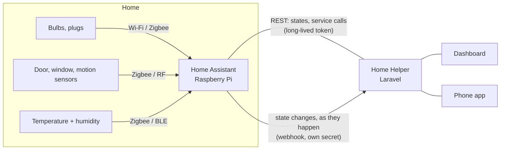

# Setting up Home Assistant

Home Helper doesn't talk to light bulbs and door sensors itself. **Home Assistant** does that:
it speaks Zigbee, Wi-Fi, Bluetooth, Tuya/Smart Life, BroadLink and some 3,000 other
integrations, and gives Home Helper one API for all of them. Home Helper adds what Home
Assistant doesn't know about: the household, its members and rooms, the assistant, approvals
and the rest of the app.



There are two ways to run it: a **Raspberry Pi at home** (the real thing) or the **test home** in
Docker, which the tests use and which you can run on any computer.

## The test home (Docker, 2 minutes)

```bash
docker compose --profile smart-home up -d homeassistant
docker exec homeassistant python3 /hh-scripts/onboard.py | tail -1   # prints a token
```

That's a real Home Assistant, current stable release, at <http://localhost:8123>
(user `owner`, password `home-helper-test`). Its devices are simulated
([`packages/test_home.yaml`](../../ops/home-assistant/config/packages/test_home.yaml)): three
lights, three plugs and switches, temperature and humidity in three rooms, two doors, a window,
a motion sensor and a lock, in five rooms. The `sim_*` helpers play the physical world: turn on
`input_boolean.sim_front_door_open` and the front door opens.

`onboard.py` does the onboarding wizard through the API (owner account, location, rooms) and
creates a long-lived access token, so the whole thing is scriptable.

## A Raspberry Pi at home

What I'd use, and what the guide pointed at:

| Part                                                                               | Why                                                                            |
| ---------------------------------------------------------------------------------- | ------------------------------------------------------------------------------ |
| Raspberry Pi 4 (4 GB) or 5, official power supply                                  | Home Assistant OS runs well on it; 5 W                                         |
| A 64 GB+ SSD over USB, or a good A2 SD card                                        | SD cards wear out under a database; an SSD lasts                               |
| A Zigbee USB stick (e.g. Sonoff ZBDongle-E / SkyConnect), on a USB extension cable | Most cheap sensors are Zigbee; the cable keeps it away from USB 3 interference |
| Smart lights / plugs from the shop (Hue, IKEA, Tuya/Smart Life, Shelly)            | Shelly and Hue work locally; Tuya/Smart Life goes through their cloud          |
| Door/window contact sensors, temperature + humidity sensors (Aqara, Sonoff, IKEA)  | Zigbee, battery-powered for a year or two                                      |
| A BroadLink hub and its radar (microwave) motion sensor kit                        | The BroadLink integration; radar sees someone sitting still, PIR doesn't       |

### Install

1. **Flash Home Assistant OS.** Raspberry Pi Imager → _Other specific-purpose OS → Home
   assistants and home automation → Home Assistant_ → your Pi model → the SSD/SD card.
2. **Boot it on wired Ethernet** and wait ~5 minutes, then open <http://homeassistant.local:8123>.
3. **Onboard:** owner account, home location (used for sunset), time zone, units.
4. **Add the devices:** _Settings → Devices & services → Add integration_:
    - Zigbee stick → **ZHA**, then _Add device_ and pair each sensor (hold its button).
    - Tuya / Smart Life devices → **Tuya** (log in with the Smart Life app account, scan the QR code).
    - BroadLink hub → **BroadLink** (found automatically on the network).
    - Hue, IKEA, Shelly → usually discovered on their own.
5. **Give everything a room:** _Settings → Areas_ — name them like your rooms in Home
   Helper (Living room, Kitchen, ...); Home Helper matches them by name.
6. **Give the Pi a fixed address** in the router (DHCP reservation), e.g. `192.168.1.20`.

### Connect it to Home Helper

On the Pi: _Profile (bottom left) → Security → Long-lived access tokens → Create token_, name it
"Home Helper". Then in Home Helper: _Smart home → Connect_: the address
(`http://192.168.1.20:8123`) and the token. The rest is in [smart-home.md](../smart-home.md).

> **Where Home Helper runs matters.** It must be able to reach the Pi's address. Home Helper on
> the same network (a mini PC, the same Pi, a NAS): direct. Home Helper in the cloud: use
> Home Assistant's own remote access (Nabu Casa) or a tunnel (Tailscale, Cloudflare Tunnel);
> never forward port 8123 on the router.

### Back it up

_Settings → System → Backups_: automatic daily backups, copied off the Pi (Google Drive / a NAS
add-on). A Home Assistant restore puts every paired device back without re-pairing.

## Hardware I don't have yet

The test home stands in for real devices so every test runs anywhere, including CI. What it
can't show is radio range, battery life, a Zigbee mesh losing a router, or a Tuya cloud outage.
[smart-home-testing.md](smart-home-testing.md) lists what was tested against the test home and
the checklist for a real house.
