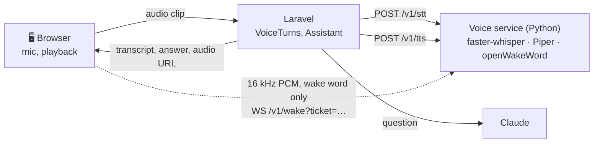

# Voice

Phase 4 ([phase-4.md](phase-4.md)): you can talk to Home Helper instead of typing. Say "Hey Jarvis", ask "what do I need to buy?", hear the answer, and keep talking.

## Choosing the speech technology (day 43)

A voice assistant in a home hears everything said near it, so the first requirement was **privacy**: audio should not leave the house. The second was that it runs on the hardware a household has (a mini PC or a laptop, no GPU), and the third that each part sits behind an interface so it can be replaced.

### Speech to text

| Option | Where it runs | Quality | Cost | Verdict |
|---|---|---|---|---|
| **faster-whisper** (Whisper on CTranslate2) | Locally, CPU, int8 | Whisper `small`: good for short household questions, 99 languages including Greek | Free | **Chosen** |
| whisper.cpp | Locally, CPU | Same models | Free | Equivalent; faster-whisper fits a Python service and decodes WebM/Opus from the browser directly (PyAV) |
| Vosk / Kaldi | Locally | Clearly worse on free speech | Free | Fast, but not accurate enough |
| Browser Web Speech API | **Google's servers** (Chrome), varies by browser | Good | Free | Kept only as a fallback when no service runs; it sends audio to the browser vendor |
| Cloud APIs (OpenAI, Deepgram, Google, Azure) | Their servers | Best | Per minute | Every question would leave the house |

faster-whisper runs Whisper about 4× faster than the reference implementation at the same accuracy, and with `vad_filter` it cuts the silence around a question (and the text Whisper sometimes invents in it). On a 4-core CPU, `small` at int8 transcribes a 4-second question in roughly a second; `base` is faster and less accurate, `medium` the other way (`VOICE_STT_MODEL`).

### Text to speech

| Option | Where | Verdict |
|---|---|---|
| **Piper** (OHF-Voice/piper1-gpl) | Locally, faster than real time on a CPU | **Chosen**: natural neural voices in many languages and accents, ~60 MB each |
| Coqui XTTS | Locally, needs a GPU to be quick | Better voices, too slow on a CPU |
| Browser `speechSynthesis` | The device | Fallback: free and instant, but the voice depends on the device |
| Cloud TTS | Their servers | Same privacy problem as cloud STT |

Voices installed by default: `en_GB-alan-medium` (a British male voice, the Jarvis one), `en_US-lessac-medium`, `en_GB-jenny_dioco-medium`, `en_US-ryan-high`, and `el_GR-rapunzelina-low` (Greek).

### Wake word

| Option | Verdict |
|---|---|
| **openWakeWord** | **Chosen**: open source, runs locally, ships a pre-trained **"hey jarvis"** model, scores each 80 ms frame |
| Porcupine (Picovoice) | Very good and runs in the browser, but needs an account key and custom words are paid |
| Matching the transcript of everything said | Would mean transcribing everything the microphone hears |

The browser streams 16 kHz audio to the service over a WebSocket only while wake-word listening is on, and only the detector sees it: no transcript is made until the wake word is heard.

### The result

One **separate Python service** (`services/voice`, FastAPI) holds the three engines: they are Python libraries, they need a few hundred MB of models loaded once, and they should not slow down or crash the Laravel app. Laravel talks to it over HTTP with a shared token and never stores audio; the browser only connects to it for the wake word, with a short-lived ticket Laravel signs.



## The voice service (days 44–45)

`services/voice`: FastAPI, one process.

| Endpoint | What |
|---|---|
| `GET /health` | Liveness and configuration, no token |
| `POST /v1/stt` | Multipart `audio` (WebM/Opus, Ogg, MP4, WAV) and an optional `language` → `{text, language, language_probability, duration, segments, processing_seconds}`. 10 MB and 60 s at most |
| `POST /v1/tts` | `{text, voice, rate}` → `audio/wav` (rate 0.5–2.0; 2,000 characters at most) |
| `GET /v1/voices` | The configured voices and whether each is installed |
| `WS /v1/wake?ticket=…` | Binary frames of 16 kHz mono int16 PCM in; `{"event": "ready"}` then `{"event": "wake", "word", "score"}` out |

- **Authentication:** HTTP calls need `Authorization: Bearer $VOICE_SERVICE_TOKEN`. The socket needs a ticket `user.expires.hmac` signed with the same token (HMAC-SHA256 over `wake:<user>:<expires>`), and the page's origin must be in `VOICE_ALLOWED_ORIGINS`.
- **Nothing is kept:** audio is read into memory, written to a temporary file only for the decoder, and deleted with the request. Logs hold sizes and timings, never text.
- **Models in the image:** `download-models.sh` fetches the Whisper model, the Piper voices and the wake-word model at build time, so the running service needs no internet.
- **Fake engines** (`VOICE_ENGINES=fake`): no models; audio starting with `TEXT:` "says" the rest, speech is a real WAV tone, a loud frame wakes. The pytest suite and CI use them.

```bash
docker compose --profile voice up -d voice   # build once: ~1 GB with Whisper small
cd services/voice && python -m pytest        # the API with fake engines
```
