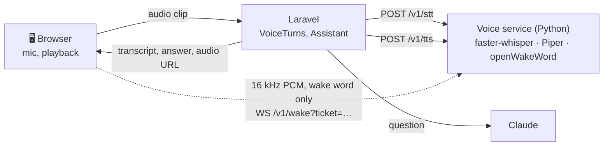

# Voice

Phase 4 ([phase-4.md](phase-4.md)): you can talk to Home Helper instead of typing. Say "Hey Jarvis", ask "what do I need to buy?", hear the answer, and keep talking.

## Choosing the speech technology (day 43)

A voice assistant in a home hears everything said near it, so the first requirement was **privacy**: audio should not leave the house. The second was that it runs on the hardware a household has (a mini PC or a laptop, no GPU), and the third that each part sits behind an interface so it can be replaced.

### Speech to text

| Option | Where it runs | Quality | Cost | Verdict |
|---|---|---|---|---|
| **faster-whisper** (Whisper on CTranslate2) | Locally, CPU, int8 | Whisper `small`: good for short household questions, 99 languages including Greek | Free | **Chosen** |
| whisper.cpp | Locally, CPU | Same models | Free | Equivalent; faster-whisper fits a Python service and decodes WebM/Opus from the browser directly (PyAV) |
| Vosk / Kaldi | Locally | Clearly worse on free speech | Free | Fast, but not accurate enough |
| Browser Web Speech API | **Google's servers** (Chrome), varies by browser | Good | Free | Kept only as a fallback when no service runs; it sends audio to the browser vendor |
| Cloud APIs (OpenAI, Deepgram, Google, Azure) | Their servers | Best | Per minute | Every question would leave the house |

faster-whisper runs Whisper about 4× faster than the reference implementation at the same accuracy, and with `vad_filter` it cuts the silence around a question (and the text Whisper sometimes invents in it). On a 4-core CPU, `small` at int8 transcribes a 4-second question in roughly a second; `base` is faster and less accurate, `medium` the other way (`VOICE_STT_MODEL`).

### Text to speech

| Option | Where | Verdict |
|---|---|---|
| **Piper** (OHF-Voice/piper1-gpl) | Locally, faster than real time on a CPU | **Chosen**: natural neural voices in many languages and accents, ~60 MB each |
| Coqui XTTS | Locally, needs a GPU to be quick | Better voices, too slow on a CPU |
| Browser `speechSynthesis` | The device | Fallback: free and instant, but the voice depends on the device |
| Cloud TTS | Their servers | Same privacy problem as cloud STT |

Voices installed by default: `en_GB-alan-medium` (a British male voice, the Jarvis one), `en_US-lessac-medium`, `en_GB-jenny_dioco-medium`, `en_US-ryan-high`, and `el_GR-rapunzelina-low` (Greek).

### Wake word

| Option | Verdict |
|---|---|
| **openWakeWord** | **Chosen**: open source, runs locally, ships a pre-trained **"hey jarvis"** model, scores each 80 ms frame |
| Porcupine (Picovoice) | Very good and runs in the browser, but needs an account key and custom words are paid |
| Matching the transcript of everything said | Would mean transcribing everything the microphone hears |

The browser streams 16 kHz audio to the service over a WebSocket only while wake-word listening is on, and only the detector sees it: no transcript is made until the wake word is heard.

### The result

One **separate Python service** (`services/voice`, FastAPI) holds the three engines: they are Python libraries, they need a few hundred MB of models loaded once, and they should not slow down or crash the Laravel app. Laravel talks to it over HTTP with a shared token and never stores audio; the browser only connects to it for the wake word, with a short-lived ticket Laravel signs.



## The voice service (days 44–45)

`services/voice`: FastAPI, one process.

| Endpoint | What |
|---|---|
| `GET /health` | Liveness and configuration, no token |
| `POST /v1/stt` | Multipart `audio` (WebM/Opus, Ogg, MP4, WAV) and an optional `language` → `{text, language, language_probability, duration, segments, processing_seconds}`. 10 MB and 60 s at most |
| `POST /v1/tts` | `{text, voice, rate}` → `audio/wav` (rate 0.5–2.0; 2,000 characters at most) |
| `GET /v1/voices` | The configured voices and whether each is installed |
| `WS /v1/wake?ticket=…` | Binary frames of 16 kHz mono int16 PCM in; `{"event": "ready"}` then `{"event": "wake", "word", "score"}` out |

- **Authentication:** HTTP calls need `Authorization: Bearer $VOICE_SERVICE_TOKEN`. The socket needs a ticket `user.expires.hmac` signed with the same token (HMAC-SHA256 over `wake:<user>:<expires>`), and the page's origin must be in `VOICE_ALLOWED_ORIGINS`.
- **Nothing is kept:** audio is read into memory, written to a temporary file only for the decoder, and deleted with the request. Logs hold sizes and timings, never text.
- **Models in the image:** `download-models.sh` fetches the Whisper model, the Piper voices and the wake-word model at build time, so the running service needs no internet.
- **Fake engines** (`VOICE_ENGINES=fake`): no models; audio starting with `TEXT:` "says" the rest, speech is a real WAV tone, a loud frame wakes. The pytest suite and CI use them.

```bash
docker compose --profile voice up -d voice   # build once: ~1 GB with Whisper small
cd services/voice && python -m pytest        # the API with fake engines
```

### Checked with the real models (day 49 review)

The fake engines prove the API; the real image was built and run too (`VOICE_STT_MODEL=base`, a laptop CPU, no GPU):

| Check | Result |
|---|---|
| Piper speaks "You need milk, bread and coffee. The basil needs water today." (Alan) | 187 KB WAV in 1.5 s |
| Whisper transcribes that audio | Word for word, English at p = 0.98 |
| Laravel's `VoiceServiceClient`: a speakable answer → speech → text | "to buy milk, bread and coffee. It's 12 euros 40 in all." (4.7 s of audio in 2.6 s) |
| Wake word: Piper saying "Hey Jarvis" (two voices), streamed at 16 kHz | Detected, scores 0.91–0.96 |
| Wake word: "What do I need to buy today?" | Not detected |
| A wrong service token | 401 |
| Greek round trip with `base` | Recognisably Greek but misspelt: use `small` or larger for Greek |

The review found three problems the fake engines could not: openWakeWord 0.6 requires `tflite-runtime` on Linux, which has no Python 3.12 wheels (it is now installed with `--no-deps` and runs on ONNX Runtime); PyAV 16+ removed an argument faster-whisper 1.2.1 still passes (pinned `av==15.1.0`); and the base image already has a `voice` group (the service user is `helper`).

## The voice turn (day 46)

`App\Voice\VoiceTurns::handle()`:

1. **Speech to text** through the `SpeechToText` interface: the voice service, or nothing at all when the browser already recognised the words and sent them as `text`. Silence (or Whisper's habit of hearing "Thank you." in noise) answers "Sorry, I didn't catch that." without asking the model.
2. **"Confirm" / "cancel".** A short yes or no while exactly one change waits in the conversation confirms or declines it, hands-free, through the same `Assistant::confirm()` as the button.
3. **The assistant**, with `TurnOptions`: the person's response style is added to the context ("This answer will be spoken aloud…"), and a cancellation check runs between model rounds.
4. **Speakable text**, then **text to speech** in the person's voice and speed. The WAV is cached for 10 minutes behind a temporary signed URL (`/voice/audio/{id}`), so the phone can play it too. If text to speech fails, the answer still arrives and the browser reads it out.

Conversations started by voice have `channel = voice`, so their privacy rules can differ from typed ones.

### API

| Method and path | What |
|---|---|
| `GET /api/voice` | Your settings, the voices and styles, and a wake-word socket URL with a fresh ticket when the wake word is on |
| `PATCH /api/voice` | `voice`, `style`, `rate`, `language`, `wake_word`, `continuous`, `keep_days`, `remember` |
| `POST /api/households/{h}/voice/turns` | Multipart `audio` or `text`, your `turn_id`, optional `conversation_id` → `heard`, `reply`, `spoken`, `audio_url`, `messages`, `actions`, `cancelled` |
| `POST /api/households/{h}/voice/turns/{turn_id}/cancel` | Stops that turn at its next step (202) |
| `POST /api/voice/speak` | `{text, voice?, rate?}` → `audio_url` ("try this voice") |
| `DELETE /api/voice/history` | Deletes all your voice conversations |

Errors: `503 voice_unavailable` (the service is down: nothing was asked), `422 audio_unusable` (no speech engine for audio, or audio that can't be decoded). The dashboard uses the same endpoints under `/voice/*` with the session.

## Spoken responses (day 48)

A written answer is rewritten for the ear by `App\Voice\Speakable`: a list becomes one sentence ("Milk, Bread and Coffee."), markdown, links and ids go, `2026-11-14` becomes "Saturday 14 November", `€1,234.50` becomes "1234 euros 50", `°C`, `km/h`, `ml`, `mm` become words, and the text is cut at a sentence end before the style's length. The model is also told it is speaking, so most of this is rarely needed; the rewrite is the safety net.

## In the browser (days 47, 50–53)

The assistant page has a voice bar under the message box (`components/assistant/voice-controls.tsx`, `hooks/use-voice.ts`).

### The conversation loop

`lib/voice/machine.ts` is a pure state machine, tested on its own:

```
off ──press──▶ listening ──pause──▶ thinking ──answer──▶ speaking ──done──▶ listening (follow-up)
                  ▲                                         │ you talk: interrupt      │ silence: back to rest
waiting ──"Hey Jarvis"──┘                                   ▼                          ▼
                                                        listening                 waiting / off
```

- **Push to talk:** the mic button or **Space**. **Escape** or **Stop** cancels: the request is aborted, the server is told to stop the turn, and playback stops.
- **Knowing when you stopped** (`lib/voice/vad.ts`): voice activity detection by loudness. It learns the room's background level, counts speech once the level stays three times above it for 120 ms, and ends the question after 900 ms of quiet, so you don't press anything. Nothing said for 8 s closes the microphone.
- **Continuous conversation (day 52):** after an answer it listens for 6 seconds for a follow-up, without the wake word. The same conversation continues, with its history.
- **Interruption (day 53):** while it speaks the microphone stays open (echo-cancelled, and with a doubled threshold so the answer's own echo doesn't count); talking over it stops the audio and starts listening.
- **Wake word (day 50):** while resting with the wake word on, the page streams the microphone as 16 kHz PCM (`lib/voice/pcm.ts`) to the voice service's socket, and a chime plays when it hears "Hey Jarvis". The socket ticket expires after 15 minutes.
- **Microphone controls (day 51):** the microphone is opened only while something listens and released otherwise; a **red dot** shows whenever it is open; **Mute** closes it whatever else is on; nothing listens while the tab is in the background.
- **Without a voice service** (`VOICE_DRIVER=browser`): the browser's own speech recognition and `speechSynthesis`; there is no wake word, and the page says that the browser may send audio to its maker.

## Voices and styles (day 54)

Five Piper voices (two British, two American, one Greek) and four response styles, chosen in **Settings → Voice** with a "Try it" button:

| Style | What the model is told | Spoken at most |
|---|---|---|
| Brief | One or two short sentences, the most important first | 300 characters |
| Conversational (default) | A few natural sentences, about 60 words | 600 |
| Detailed | Up to about 120 words, "first…, then…" | 1,200 |
| Butler | A calm, courteous English butler who uses your name now and then | 450 |

Speed (0.5–2×) and the language you speak (or detection) are settings too.

## Privacy (day 55)

| | |
|---|---|
| Recordings | Never stored. Processed in memory by your own voice service and discarded |
| Spoken answers | Cached for 10 minutes behind a signed URL, then gone |
| Wake word | Off until you turn it on. Only the detector hears the stream; nothing is transcribed until it hears the wake word. Only while the assistant page is open and visible |
| Microphone | Open only while listening, with a red dot; Mute closes it |
| Voice conversations | Kept like typed ones, or deleted after 1, 7 or 30 days (`PruneVoiceConversations`, daily at 03:45) |
| Memory | "Let Home Helper remember voice conversations" off: they are never summarised or indexed |
| Delete | "Delete my voice conversations" removes them all, with their summaries |
| The service | Token for Laravel, short-lived signed tickets for browsers, allowed origins for the socket; logs sizes and timings, never words |

## Testing it (day 56)

- `services/voice/tests` (pytest, fake engines; its own CI job): authentication, limits, the shapes Laravel relies on, the socket, and the ticket signature pinned to the same value as the PHP test.
- `tests/Feature/Voice` (Pest): speakable text; the voice turn (heard, answered, spoken, playable, expiring); follow-ups; silence; browser mode; the service down; interruption; "confirm" and "no" by voice; styles and voices; tickets; retention, memory opt-out and deleting history; and `VoiceConversationTest`, a whole spoken conversation on the demo household with the offline model routing for real.
- `resources/js/test/voice.test.tsx` (Vitest): every transition of the machine, voice activity detection, PCM conversion, the voice bar (status, red dot, Space and Escape, Stop, Mute) and the settings page.
- The real models: [above](#checked-with-the-real-models-day-49-review).

Not tested automatically: a real microphone in a real browser. The hook is plumbing around the tested machine.
